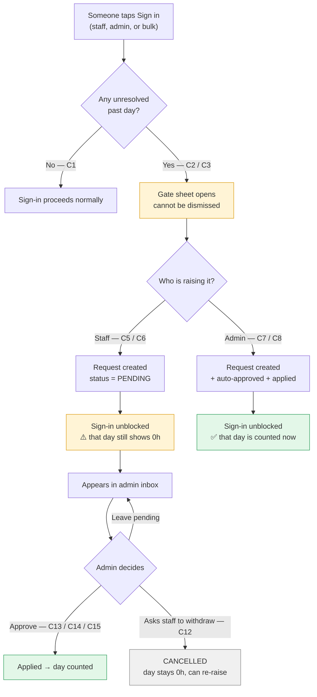
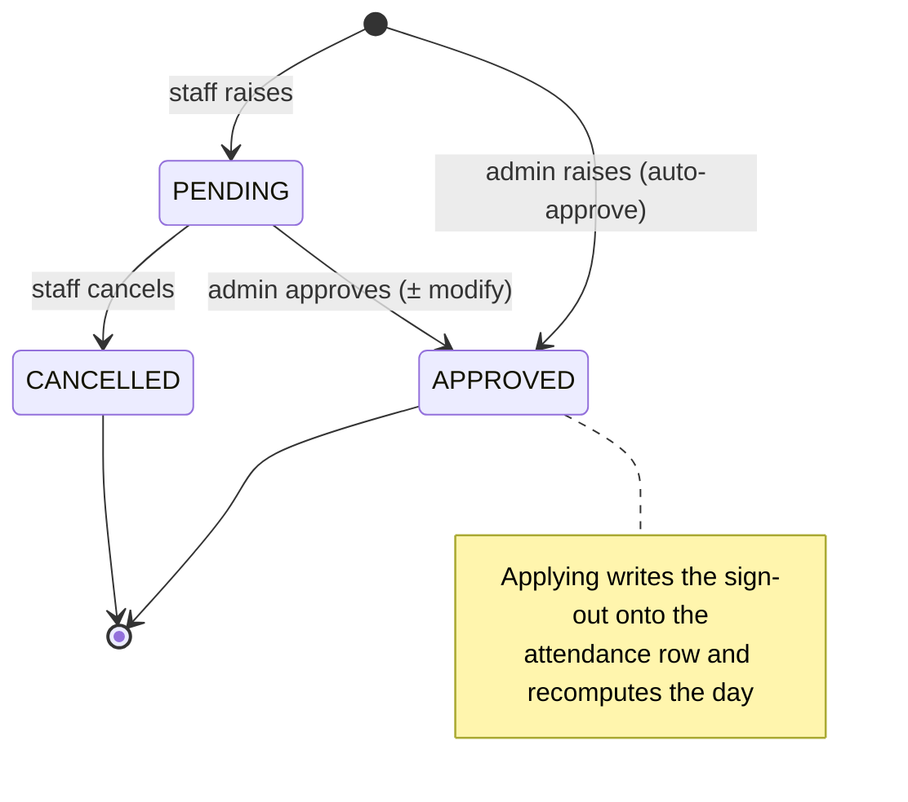
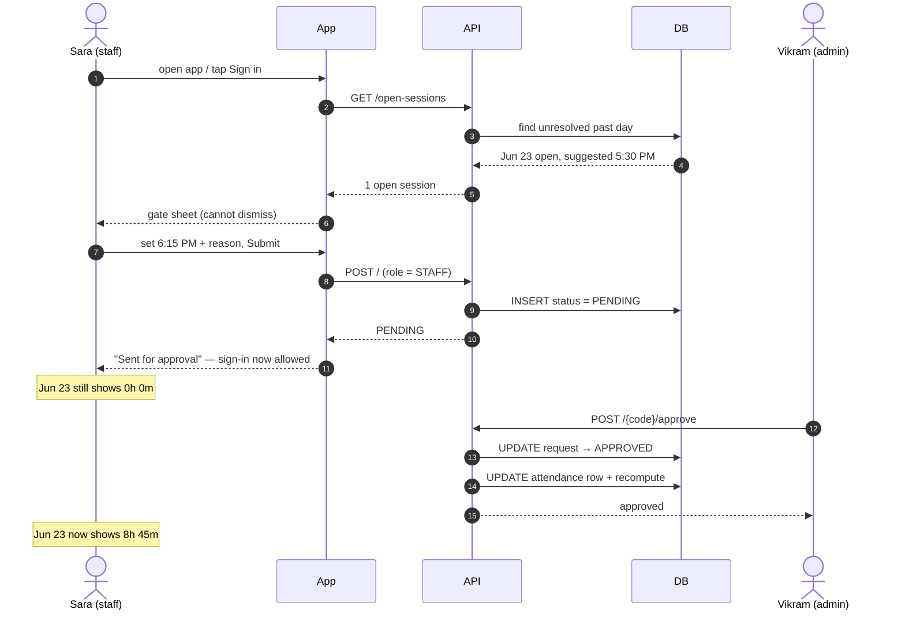
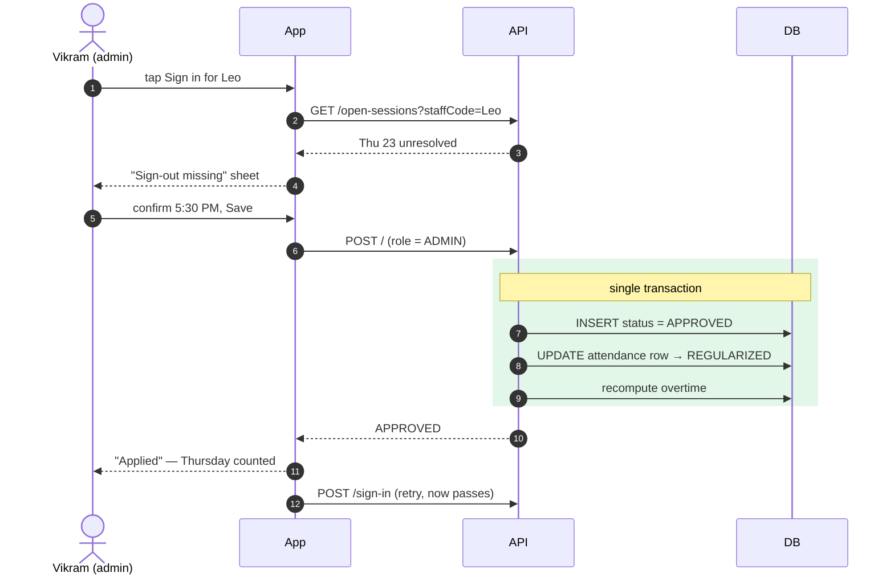
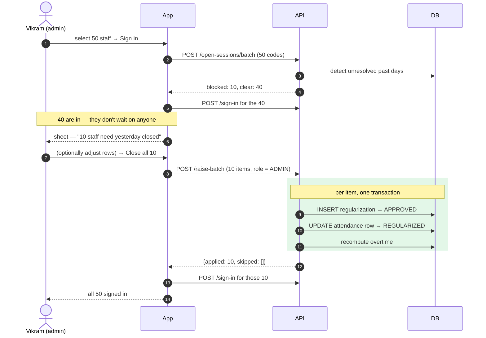
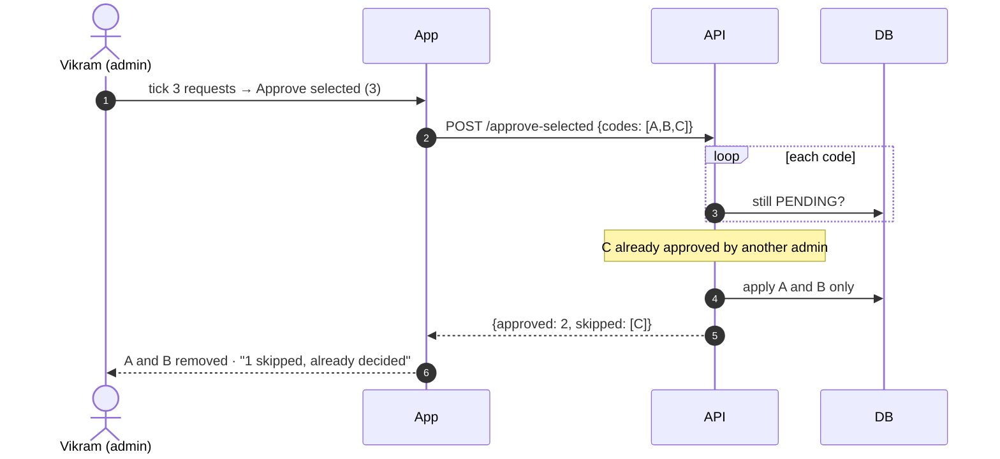

# Attendance Regularization — How It Works

**A map of the whole flow: every case, what the person sees, which API runs, what changes in the database.**

| | |
|---|---|
| **Companion doc** | [`attendance_regularization_requirements.md`](./attendance_regularization_requirements.md) — the *contract* (schema, payloads, rules). This doc is the *map* (how it all moves). |
| **Read this if you are** | a founder or PM → §1 · a frontend dev → §3, §4, §5 · a backend dev → §4, §6, §7 · QA → §3, §4 |
| **Cast used in examples** | **Sara Malik** — teacher · **Vikram Bose** — school admin · **Leo Martins** — teacher |

---

## §0 · TL;DR

Staff sometimes forget to sign out. That leaves a day with no end time, so their hours can't be counted.

Regularization fixes it with one rule: **before you can sign in again, yesterday must be closed.** The person raises a short request saying what time they actually left. A staff-raised request waits for admin approval; an admin-raised one is approved instantly. Until it's approved, that day shows **0 hours** — which is the nudge to deal with it.

---

## §1 · The story, in plain English

*No jargon. If you only read one section, read this one.*

### What goes wrong

Sara teaches all day Monday. At 5:30pm she walks out without tapping "Sign out." Her Monday record now has a start time but no end time — the system has no idea whether she left at 3pm or 8pm, so it can't pay her for the day.

Left alone, that day quietly stays broken forever.

### How we fix it

**Tuesday morning, Sara opens the app to sign in.** Instead of signing in, she gets a sheet she can't dismiss:

> **Finish yesterday first**
> You didn't sign out on Jun 23, so that day is still open.
> *Until this is approved, that day's hours won't be counted.*
> **Actual sign-out time:** `5:30 PM` *(pre-filled with the school's closing time)*
> **Reason** *(optional)*
> **[ Confirm & submit ]**

She has two choices, and both take seconds:

- **The pre-filled time is right** → tap Submit. Done.
- **She actually left at 6:15pm** → tap the time, change it, type a quick reason ("stayed for parent meeting"), submit.

Either way her request goes to the admin, and **she can now sign in for Tuesday.** We don't make her wait on an approval to start her workday.

### What the admin does

Vikram opens the Regularization inbox and sees Sara's request: the date, what she's asking for, her reason. He can:

- **Approve it** as submitted — Monday's hours are now counted.
- **Approve it with a change** — if he knows she really left at 6:00, he adjusts the time, notes why, and approves.
- **Leave it pending** — if something looks off, he talks to her and asks her to cancel it.

He can also **tick several requests and approve them together** when a batch comes in on Monday morning.

There is deliberately **no Reject button.** Rejecting would leave the day broken with no path forward. Instead the admin either fixes the time himself or asks the staff member to withdraw and re-raise.

### The shortcut when an admin signs someone in

Some schools have an admin sign everyone in from the front desk. If Vikram tries to sign in Leo, and Leo never signed out yesterday, **Vikram hits the same gate** — with wording aimed at him:

> **Sign-out missing**
> Leo Martins never signed out on Jun 23. Add the sign-out before signing them in again.
> *As an admin your correction is approved automatically — the day is counted as soon as you save.*

Because Vikram **is** the approver, his correction skips the queue entirely. No pending request, no second step.

### When the admin signs in the whole team at once

Vikram selects 50 staff and taps Sign in. 10 of them never signed out yesterday.

> **10 staff need yesterday closed**
> *40 others will sign in normally*
> Sara Malik · Jun 23 · in 7:37a → `5:30 PM`
> Leo Martins · Jun 23 · in 7:40a → `5:30 PM`
> … 8 more …
> **[ Close all 10 & sign them in ]**
> *Skip — sign in the other 40*

The 40 unaffected staff sign in straight away — nobody waits on someone else's forgotten sign-out. The 10 appear on **one** sheet, each pre-filled with the school's closing time, so the usual case is **a single tap**. If Vikram knows one of them actually left at 6:15, he taps that row and fixes just that person. Because he's an admin, all 10 are approved instantly, and then they're signed in.

**Cold start warning:** on a school's very first morning, no gate has ever run, so many staff may be blocked at once. After that first cleanup the gate keeps it down to the day's stragglers. Expect it; it isn't a bug.

### Why nobody ever has a pile of these

The gate blocks **every** way of signing in — Sara herself, Vikram on her behalf, and bulk sign-in. So the previous open day always gets cleared before a new one can start. A staff member can never accumulate more than **one** unresolved day. There is no "catch up on 10 days" screen because that situation can't happen.

### Three worked examples

**① The easy one — Sara, 8 seconds**
> Mon 5:30pm — leaves without signing out.
> Tue 7:35am — opens app, sheet appears, the pre-filled 5:30pm is correct, taps **Confirm & submit**, signs in normally.
> Tue 9:10am — Vikram approves from his inbox. Monday now reads **8h 0m**.

**② The correction — Sara, with a reason**
> Wed 6:15pm — stays late for a parent meeting, forgets again.
> Thu 7:40am — sheet appears pre-filled 5:30pm. She taps the time, sets **6:15 PM**, types *"parent meeting"*, submits. Signs in.
> Thu — until Vikram approves, Wednesday shows **0h 0m** on her profile.
> Thu 11:00am — Vikram approves. Wednesday becomes **8h 45m**, of which **45m is overtime.**

**③ The front-desk one — Vikram signs Leo in**
> Fri 7:30am — Vikram taps sign-in for Leo. Blocked: Leo never signed out Thursday.
> Vikram sets **5:30 PM**, taps **Save sign-out**. It applies immediately — Thursday is counted on the spot.
> He then signs Leo in for Friday. Total detour: about 10 seconds.

---

## §2 · The whole flow on one page



**Request lifecycle**



> There is **no REJECTED state**. Approve, leave pending, or the staff cancels.

---

## §3 · Every case at a glance

**This table is the spine of the doc.** Every case has a permanent ID. Use it in bug reports, PR titles and QA runs — "C14 is broken" is unambiguous in a way that "bulk approve is broken" is not.

### A · Detection — is this day gated?

| ID | Situation | What happens |
|---|---|---|
| **C1** | No unresolved past day | Nothing. Sign-in proceeds. |
| **C2** | Past day still open — `status=SIGNED_IN`, `signed_out_at` NULL | **Gated.** Sheet opens. |
| **C3** | Past day auto-closed by the scheduler — `signed_out_method=SYSTEM`, `total_worked_minutes=0` | **Gated.** A machine guess is not a real sign-out. |
| **C4** | Session open but it's **today** | **Not gated** — the staff is still working. Only past days count. |

### B · Raising the request

| ID | Who | Action | Result |
|---|---|---|---|
| **C5** | Staff | Accepts the suggested time | `PENDING` · reason optional |
| **C6** | Staff | Changes the time | `PENDING` · **reason required** |
| **C7** | Admin | Accepts the suggested time | `APPROVED` + applied instantly |
| **C8** | Admin | Changes the time | `APPROVED` + applied instantly · reason required |
| **C9a** | Admin | Bulk sign-in — some of the selected staff are blocked | Unblocked staff **sign in immediately**; the blocked ones open one consolidated sheet |
| **C9b** | Admin | Taps **Close all N & sign them in** | All raised in one call, auto-approved, then those staff sign in |
| **C9c** | Admin | Adjusts individual rows first | Corrected rows marked "edited" (undo available); one shared reason **required** |
| **C9d** | Admin | Taps **Skip** | Unblocked staff still signed in; blocked ones left for later, gate persists |

### C · After it's raised

| ID | Situation | Result |
|---|---|---|
| **C10** | Request exists, staff signs in again | Allowed — pending is enough to unblock |
| **C11** | Same day raised twice (double-tap, retry) | Idempotent — returns the existing request, no duplicate |
| **C12** | Staff cancels a pending request | `CANCELLED`. Day stays at 0h and **is gated again** — they can re-raise |

### D · Approving

| ID | Action | Result |
|---|---|---|
| **C13** | Approve as submitted | `applied_sign_out_at = requested_sign_out_at` |
| **C14** | Approve with a modified time | `applied_sign_out_at` = admin's time. Both values kept |
| **C15** | Bulk approve selected | Each approved as submitted |
| **C16** | Bulk where some were already decided | Those are **skipped**, not errors. Response reports them |
| **C17** | Approve something already approved | No-op, returns current state |

### E · Rejected by validation

| ID | Bad input | Response |
|---|---|---|
| **C18** | Sign-out **before** sign-in | `400` — "Sign-out must be after sign-in" |
| **C19** | Sign-out past the school day window (default cap 19:00 local) | `400` — "Time is outside the school day" |
| **C20** | Time changed but no reason given | `400` — blocked client-side too |
| **C21** | Staff token tries to approve, or sends an admin flag | `403` — role comes from the token, never the payload |

### F · Edge cases

| ID | Situation | Behaviour |
|---|---|---|
| **C22** | Two admins approve the same request at once | First wins; second gets "already decided" (no error, no double-apply) |
| **C23** | Someone edits the attendance row via `PATCH /daily/{code}` **after** approval | The row changes; `applied_sign_out_at` on the request is **preserved** — the audit trail survives |
| **C24** | Network drops mid-raise, client retries | Safe — C11 idempotency covers it |
| **C25** | Client skips the pre-check and calls sign-in directly | `409 REGULARIZATION_REQUIRED`, with the open session in the payload so the app can open the sheet immediately |

---

## §4 · Case detail — trigger → screen → API → database

### C2 / C3 · The gate fires

**Trigger.** App open, or any sign-in attempt for that staff.

**API**
```
GET /api/v1/staff-attendance-regularizations/open-sessions?staffCode=STF_...
```
**Detection query**
```sql
(
     (status = 'SIGNED_IN'  AND signed_out_at IS NULL)
  OR (status = 'SIGNED_OUT' AND signed_out_method = SYSTEM AND total_worked_minutes = 0)
)
AND attendance_date < {today, school-local}
AND deleted_at IS NULL
```

**Response** → `attendanceCode`, `attendanceDate`, `signedInAt`, `suggestedSignOutAt`, `classroomCode`, `hasPendingRequest`

**Where `suggestedSignOutAt` comes from**
1. The scheduler's own `signed_out_at`, if the row was SYSTEM-closed *(C3 — best guess, and the staff will recognise it)*
2. Otherwise the school schedule's closing time for that weekday
3. Otherwise the 19:00 local fallback cap

**Screen.** Non-dismissible bottom sheet, pre-filled with the suggested time.
**DB.** Nothing — read only.

---

### C5 / C6 · Staff raises

**API**
```
POST /api/v1/staff-attendance-regularizations
{
  "staffCode": "STF_...",  "attendanceDate": "2026-06-23",
  "attendanceCode": "STAR_...",  "requestedSignOutAt": "2026-06-23T22:30:00Z",
  "confirmedSuggestedTime": false,  "reason": "parent meeting",
  "method": "APP",  "timeZone": "America/New_York"
}
```

**DB — one insert, nothing else touched**

| Table | Change |
|---|---|
| `staff_attendance_regularization` | **INSERT** · `status=PENDING` · `raised_by_role=STAFF` · `auto_approved=false` |
| `staff_attendance_record` | *unchanged* — still 0 hours |

**Result.** Sign-in unblocked. Day still reads **0h 0m** until approved.

---

### C7 / C8 · Admin raises → auto-approved

Same endpoint. The server reads the **authenticated role** — never a field in the body — and takes the auto-approve branch.

**DB — insert + apply, in one transaction**

| Table | Change |
|---|---|
| `staff_attendance_regularization` | **INSERT** · `status=APPROVED` · `raised_by_role=ADMIN` · `auto_approved=true` · `decided_by_code`, `decided_at`, `applied_sign_out_at` all set |
| `staff_attendance_record` | **UPDATE** · `signed_out_at` · `signed_out_by_code` · `signed_out_method=REGULARIZED` · `status=SIGNED_OUT` · `total_worked_minutes` recomputed · `is_regularized=true` · `regularization_code` |
| overtime | recomputed for that `(staff, date)` |

**Result.** Day counted immediately. Sheet says *"applied"*, not *"sent for approval"*.

---

### C13 / C14 · Admin approves from the inbox

**API**
```
POST /api/v1/staff-attendance-regularizations/{code}/approve
{ "signOutAt": "2026-06-23T22:45:00Z",   // omit to approve as submitted
  "note": "confirmed with lead", "timeZone": "America/New_York" }
```

Identical DB effect to C7/C8, with `decided_by_code` = the approving admin and `auto_approved` left `false`.

> **Why both times are kept.** `requested_sign_out_at` (what Sara asked for) and `applied_sign_out_at` (what Vikram committed) are stored separately and permanently. The attendance row's `signed_out_at` can be edited later by an unrelated flow (C23), so it cannot be trusted as the record of what was approved.

---

### C15 / C16 · Bulk approve

**API**
```
POST /api/v1/staff-attendance-regularizations/approve-selected
{ "schoolCode": "SCH_...", "codes": ["SREG_A", "SREG_B", "SREG_C"] }
```

- `codes` is **required** — the admin always picks the set. There is no "approve everything" button.
- Each is approved **as submitted**; modifying a time is the single-approve path.
- Already-decided items land in `skipped`, they do not fail the batch.

```json
{ "success": true,
  "data": { "approved": 2, "skipped": [ { "code": "SREG_C", "reason": "already decided" } ] } }
```

**UI.** The 2 approved rows disappear; the skipped one stays with a message.

---

### C12 · Staff cancels

```
POST /api/v1/staff-attendance-regularizations/{code}/cancel
```
`status → CANCELLED`. The attendance row is untouched, so the day is **gated again** on the next sign-in — which is exactly right: the day is still broken and needs a fresh request.

---

### C9a–C9d · Bulk sign-in with blocked staff

**Step 1 — check everyone in one call.** The single-staff GET would mean 50 round trips.
```
POST /api/v1/staff-attendance-regularizations/open-sessions/batch
{ "staffCodes": ["STF_A", ... 50 codes ] }

→ { "blocked": [ { staffCode, staffName, attendanceCode, attendanceDate,
                   signedInAt, suggestedSignOutAt, hasPendingRequest } ],
    "clear":   [ "STF_B", "STF_C", ... ] }
```

**Step 2 — sign in `clear` immediately (C9a).** Partial success is mandatory: never fail 40 people because 10 forgot to sign out.

**Step 3 — one consolidated sheet for `blocked`.** Rows sorted by staff name, each pre-filled with that person's `suggestedSignOutAt`. Edited rows show an undo. One shared reason field — **optional while every row is at its suggested time, required as soon as any row is corrected (C9c)**.

**Step 4 — apply in one call (C9b).**
```
POST /api/v1/staff-attendance-regularizations/raise-batch
{ "timeZone": "...", "reason": "forgot to sign out",
  "items": [ { staffCode, attendanceCode, attendanceDate,
               requestedSignOutAt, confirmedSuggestedTime } ] }

→ { "applied": 9, "skipped": [ { "attendanceCode": "STAR_C", "reason": "already resolved" } ] }
```
Admin-raised ⇒ every item is auto-approved and applied (§8.2b of the spec). **DB per item:** insert `APPROVED` regularization + update the attendance row (`REGULARIZED`, recompute minutes) + recompute overtime. Skipped items are reported, not errors.

**Step 5 — sign in the newly-cleared staff.**

**C9d — Skip.** The sheet closes, the `clear` staff are already signed in, and the blocked staff keep their gate for next time.

---

### C25 · The server-side backstop

Even if the client forgets to pre-check, the sign-in endpoint enforces the gate:

```
POST /api/v1/staff-attendance-records/sign-in
→ 409 REGULARIZATION_REQUIRED
  { "openSessions": [ { "attendanceCode": "...", "attendanceDate": "...", ... } ] }
```

The payload carries the open session so the app opens the sheet with **no second round-trip**. In bulk sign-in, only the offending staff is rejected and reported back; everyone else succeeds.

---

## §5 · Sequence diagrams

### Staff raises → later approved



### Admin signs a staff in → auto-approved



### Bulk sign-in — 10 of 50 blocked



### Bulk approve with a partial skip



---

## §6 · API ↔ case map

| Endpoint | Method | Cases | Tables touched |
|---|---|---|---|
| `/open-sessions` | GET | C1–C4 | reads `staff_attendance_record` |
| `/open-sessions/batch` | POST | C9a | reads `staff_attendance_record` for many staff |
| `/raise-batch` | POST | C9b, C9c | per item: inserts regularization + updates attendance + overtime |
| `/staff-attendance-regularizations` | POST | C5–C9, C11, C18–C21, C24 | inserts regularization · *(admin: also updates attendance + overtime)* |
| `/staff-attendance-regularizations` | GET | staff list, admin inbox | reads regularization *(+ batch name lookup)* |
| `/{code}/approve` | POST | C13, C14, C17, C22 | updates regularization + attendance + overtime |
| `/{code}/cancel` | POST | C12 | updates regularization only |
| `/approve-selected` | POST | C15, C16 | updates regularization + attendance + overtime, per item |
| `/staff-attendance-records/sign-in` | POST | C25, C9 | guard only — rejects with 409 |

---

## §7 · Who writes what, and when

### `staff_attendance_regularization`

| Field | Written at | By | Notes |
|---|---|---|---|
| `attendance_code` | raise | server | NOT NULL, FK to the attendance row |
| `suggested_sign_out_at` | raise | server | What the sheet offered |
| `requested_sign_out_at` | raise | raiser | What was asked for — **never overwritten** |
| `confirmed_suggested_time` | raise | server | True = suggestion accepted unchanged |
| `reason` | raise | raiser | Required when the time was changed |
| `raised_by_role` / `raised_by_code` | raise | **server, from the token** | Never from the request body |
| `status` | raise / decide | server | `PENDING` → `APPROVED` \| `CANCELLED` |
| `applied_sign_out_at` | approve | server | What was actually committed |
| `decided_by_code` / `decided_at` / `decision_note` | approve | server | |
| `auto_approved` | raise | server | True only on the admin-raise path |

### `staff_attendance_record` — changed only on approval

| Field | Before | After approval |
|---|---|---|
| `signed_out_at` | NULL *(C2)* or scheduler guess *(C3)* | `applied_sign_out_at` |
| `signed_out_method` | — or `SYSTEM` | **`REGULARIZED`** ← this is what clears the gate |
| `status` | `SIGNED_IN` or `SIGNED_OUT` | `SIGNED_OUT` |
| `total_worked_minutes` | **0** | recomputed for real |
| `is_regularized` | false | **true** |
| `regularization_code` | NULL | the `SREG_…` code |

> **Not stored anywhere:** `decided_by_name` (resolved at read time) and `time_zone` (derived from the school). `timeZone` is still **sent in every request** so the server can convert wall-clock → UTC.

---

## §8 · Who can do what

| Action | Staff | Admin |
|---|---|---|
| See their own gate | ✅ | ✅ *(for any staff they sign in)* |
| Raise a request | ✅ → `PENDING` | ✅ → **auto-approved** |
| See their own requests | ✅ | ✅ |
| Cancel a request | ✅ own only | ❌ *(asks the staff to cancel)* |
| See the school inbox | ❌ | ✅ |
| Approve / modify | ❌ | ✅ |
| Bulk approve | ❌ | ✅ |
| Reject | ❌ | ❌ **— does not exist** |

---

## §9 · Glossary

| Term | Plain meaning |
|---|---|
| **Open day** | A past day where someone signed in but never signed out. |
| **SYSTEM close** | The scheduler guessed an end time and closed the day itself. Still counts as unresolved — a guess is not a sign-out. |
| **The gate** | The sheet that blocks sign-in until the previous open day is dealt with. Can't be dismissed. |
| **Raise a request** | Say what time you actually left. Takes seconds. |
| **Regularized** | An admin has approved the time, so the day counts toward hours and pay. |
| **Auto-approved** | An admin raised it themselves, so there's nobody left to approve it — it applies instantly. |
| **Pending** | Waiting on an admin. You can still sign in; the day just doesn't count yet. |
| **Cancelled** | The request was withdrawn. The day is still open and will be gated again. |
